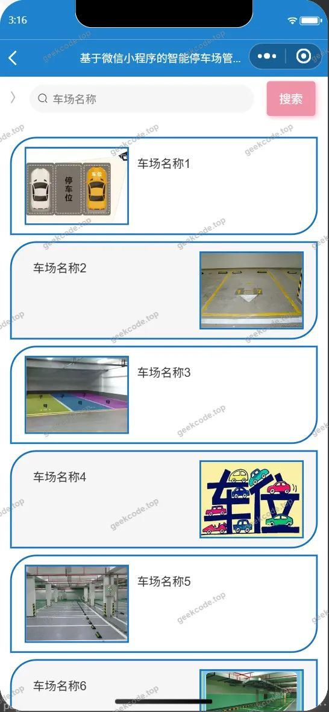
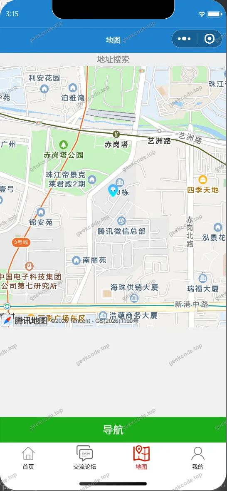
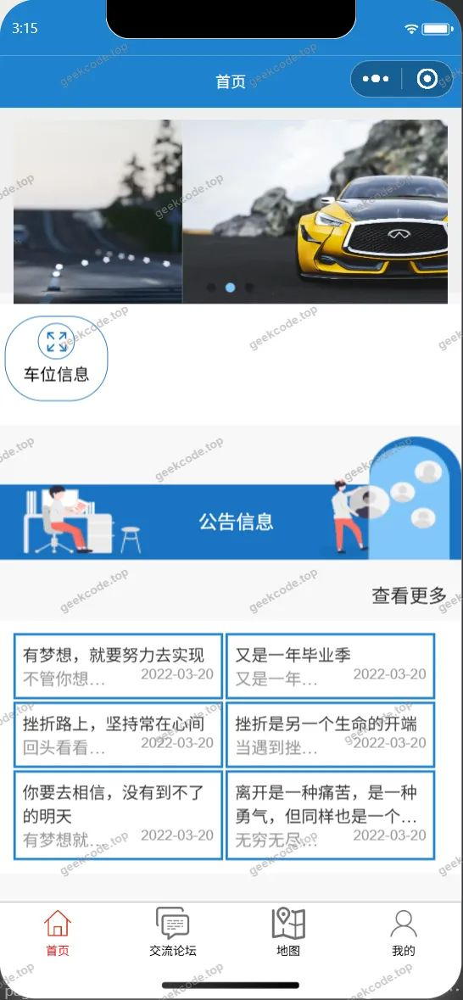
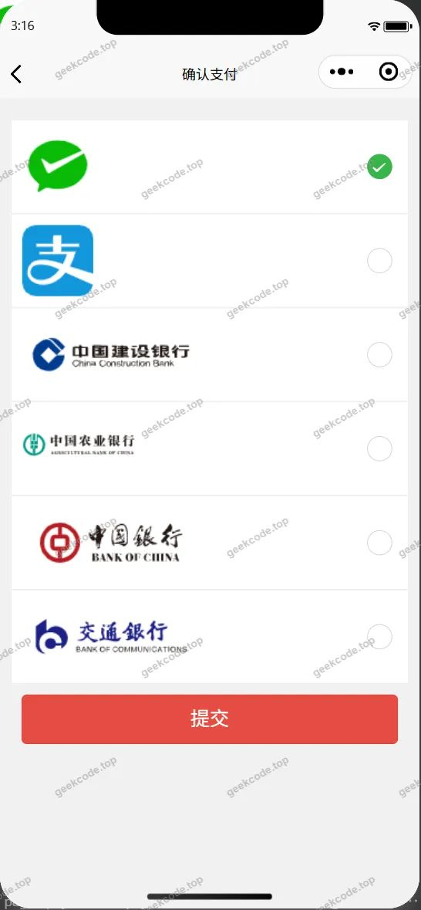
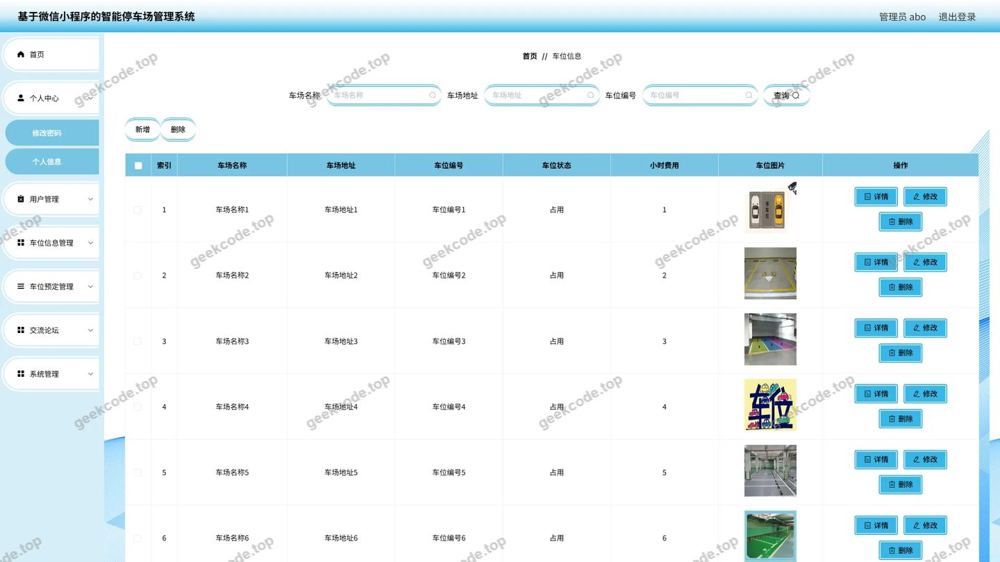
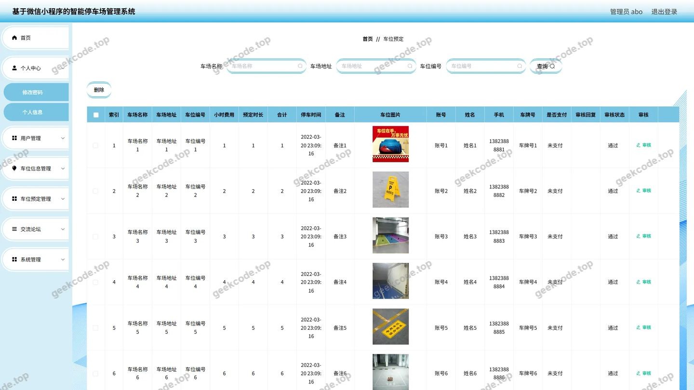
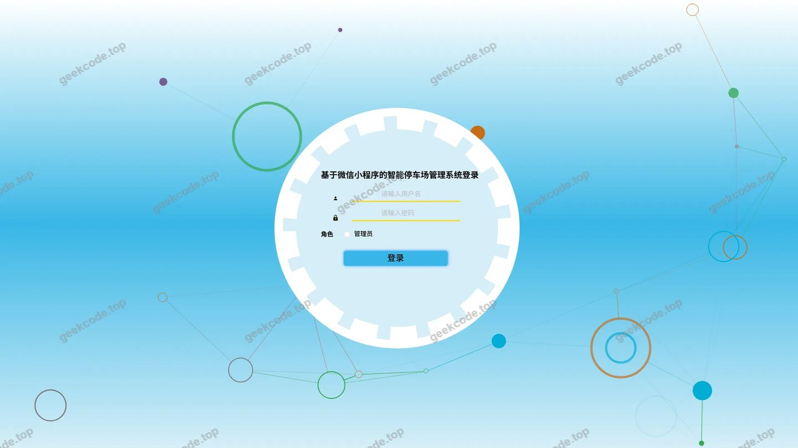
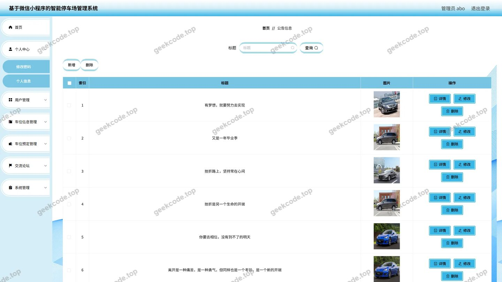
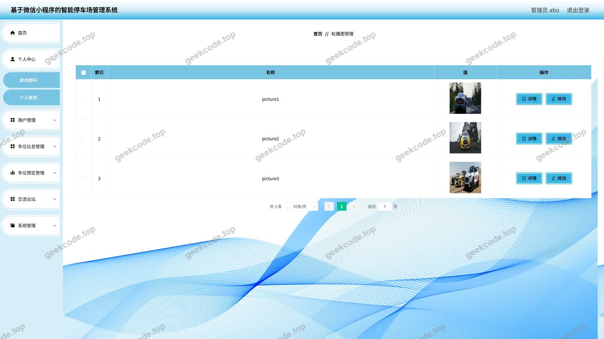
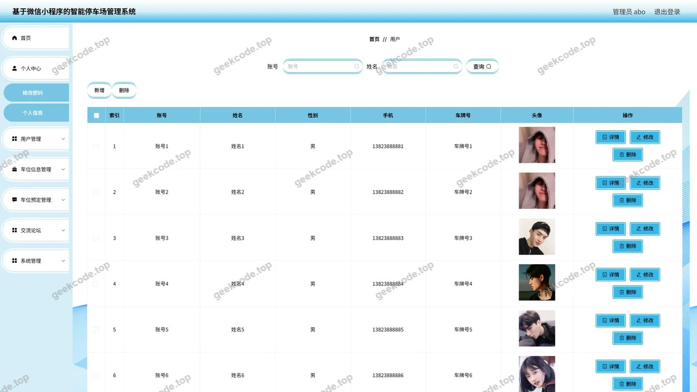

# 基于微信小程序的智能停车场管理系统--论文

> 🎓 **计算机毕业设计 · 基于微信小程序的智能停车场管理系统--论文**
>
> 本仓库只放**项目介绍 + 运行截图**（截图是站点带水印的原图，存在仓库 `images/` 里）。
>
> 👉 **完整可运行源码 / 数据库脚本 / 部署文档：[点我获取](https://geekcode.top/archives/%E5%9F%BA%E4%BA%8E%E5%BE%AE%E4%BF%A1%E5%B0%8F%E7%A8%8B%E5%BA%8F%E7%9A%84%E6%99%BA%E8%83%BD%E5%81%9C%E8%BD%A6%E5%9C%BA%E7%AE%A1%E7%90%86%E7%B3%BB%E7%BB%9F-%E8%AE%BA%E6%96%87?utm_source=github)**
>
> 💬 咨询微信：**ir9372**　|　🌐 更多项目：[极客代码 geekcode.top](https://geekcode.top/?utm_source=github)
>
> 📌 项目详情页：<https://geekcode.top/archives/%E5%9F%BA%E4%BA%8E%E5%BE%AE%E4%BF%A1%E5%B0%8F%E7%A8%8B%E5%BA%8F%E7%9A%84%E6%99%BA%E8%83%BD%E5%81%9C%E8%BD%A6%E5%9C%BA%E7%AE%A1%E7%90%86%E7%B3%BB%E7%BB%9F-%E8%AE%BA%E6%96%87?utm_source=github>

<table><td width="230" align="center"> <b>扫码加微信 ir9372</b></td><td valign="middle">📦 源码 = 项目介绍 + 全部运行截图 + 数据库 + 部署文档 👉 点上方任意截图，直接跳到 <b>极客代码 geekcode.top</b> 详情页</td></table>

---

<h1>基于微信小程序的智能停车场管理系统--论文</h1>
<h2>项目概述</h2>

本项目为“基于微信小程序的智能停车场管理系统”，旨在通过移动端与后台管理系统的协同，解决传统停车场信息不对称、车位预约流程繁琐及管理效率低下等问题。系统核心功能涵盖车位信息发布、在线预定、用户管理及公告通知等模块。适用人群包括需要快速寻找和预定车位的车主（普通用户）以及负责运营维护的管理人员。技术架构上，后端采用 Spring Boot 框架结合 MyBatis-Plus 进行数据持久化操作，前端分为 Vue 集成的管理后台与原生微信小程序端，实现了多终端覆盖的高效智能停车服务场景。

<h2>技术架构</h2>
<h3>前后端架构</h3>

系统采用前后端分离的开发模式。后端基于 Spring Boot 框架构建 RESTful API 接口，利用 Spring MVC 处理请求路由，Spring Context 管理 Bean 生命周期，并通过 spring-tx 实现事务控制。数据访问层使用 MyBatis-Plus 简化 CRUD 操作，配合 Druid 连接池优化数据库连接性能。前端分为两部分：管理后台基于 Vue.js 构建，集成 Element UI 组件库实现响应式界面；用户端基于微信小程序开发，提供轻量级、无需安装的移动服务体验。

<h3>数据库设计要点</h3>

数据库主要存储用户信息、车位状态、预定记录、论坛帖子及新闻公告等数据。通过外键关联或业务逻辑约束保证数据一致性，例如 <code>cheweiyuding</code>（车位预定表）需关联 <code>yonghu</code>（用户表）与 <code>cheweixinxi</code>（车位信息表），确保预定行为的合法性与可追溯性。

<h3>核心技术选型理由</h3>
<ol>
<li><strong>MyBatis-Plus</strong>：在保留 MyBatis 灵活性的基础上，提供了通用的 CRUD 接口和分页插件，显著减少样板代码，提升开发效率。</li>
<li><strong>Druid</strong>：作为高性能的 JDBC 连接池，具备强大的监控功能和防御 SQL 注入能力，适合企业级应用对稳定性与安全性的要求。</li>
<li><strong>微信小程序</strong>：依托微信生态，拥有巨大的用户基数和便捷的登录授权机制，降低了用户使用门槛，符合智能停车“即用即走”的场景需求。</li>
</ol>
<h2>功能模块</h2>
<h3>前台用户端（微信小程序）</h3>
<ul>
<li><strong>首页与地图服务</strong>：展示停车场概况，提供基于地理位置的地图导航功能，帮助用户快速定位附近车位。</li>
<li><strong>用户中心</strong>：包含注册、登录、忘记密码及个人信息修改功能，支持微信一键授权登录。</li>
<li><strong>车位信息管理</strong>：浏览车位信息列表，查看单个车位的详细信息（如位置、价格、状态）。</li>
<li><strong>车位预定服务</strong>：发起车位预定申请，查看个人预定列表及详情，支持支付确认流程。</li>
<li><strong>社区互动</strong>：提供论坛交流板块，允许用户发布和查看讨论内容。</li>
<li><strong>资讯公告</strong>：接收并阅读系统发布的新闻公告信息。</li>
</ul>
<h3>后台管理端（Web Admin）</h3>
<ul>
<li><strong>系统配置</strong>：管理平台基础参数设置，包括配置文件的管理。</li>
<li><strong>用户管理</strong>：对注册用户进行增删改查操作，审核用户状态，查看用户详情。</li>
<li><strong>车位信息管理</strong>：录入、编辑、删除及查询车位基本信息，维护车位实时状态。</li>
<li><strong>车位预定管理</strong>：审核和管理用户的车位预定订单，处理预定异常，查询预定记录。</li>
<li><strong>论坛管理</strong>：监控论坛帖子内容，进行必要的内容审核与管理。</li>
<li><strong>新闻公告管理</strong>：发布、编辑和删除系统公告及新闻资讯，确保信息及时触达用户。</li>
</ul>
<h2>用户角色与权限</h2>

系统主要划分为两个角色：<strong>普通用户</strong>和<strong>管理员</strong>。

<table>
<thead>
<tr>
<th align="left">角色</th>
<th align="left">权限范围</th>
<th align="left">具体功能模块</th>
</tr>
</thead>
<tbody><tr>
<td align="left"><strong>普通用户</strong></td>
<td align="left">仅限小程序端操作，聚焦于停车服务的消费侧</td>
<td align="left">1. <strong>账户管理</strong>：注册、登录、找回密码、修改个人信息。2. <strong>停车服务</strong>：浏览车位列表、查看车位详情、提交车位预定、查看我的预定、支付确认。3. <strong>信息获取</strong>：查看地图导航、阅读新闻公告。4. <strong>社交互动</strong>：参与论坛发帖与交流。</td>
</tr>
<tr>
<td align="left"><strong>管理员</strong></td>
<td align="left">拥有后台 Web 端全部权限，聚焦于资源调度与服务监管</td>
<td align="left">1. <strong>基础数据维护</strong>：管理车位信息（CRUD）、管理用户账号（CRUD）。2. <strong>业务流程管控</strong>：审核与管理车位预定订单。3. <strong>内容运营</strong>：发布和管理新闻公告、管理论坛内容。4. <strong>系统设置</strong>：配置系统参数文件。</td>
</tr>
</tbody></table>
<h2>项目特色与创新点</h2>
<ol>
<li><strong>多端协同体验</strong>：创新性地将轻量级的微信小程序作为用户入口，结合功能强大的 Web 管理后台，既满足了车主随时随地的便捷操作需求，又保障了管理人员高效的数据处理能力。</li>
<li><strong>可视化地图集成</strong>：在小程序端集成地图功能，直观展示停车场分布，解决了传统文本列表难以感知空间位置的痛点，提升了寻位效率。</li>
<li><strong>闭环预定流程</strong>：设计了从“车位浏览 -&gt; 详情确认 -&gt; 在线预定 -&gt; 支付确认 -&gt; 后台审核”的完整业务闭环，规范了停车资源的分配逻辑，减少了线下纠纷。</li>
<li><strong>模块化内容管理</strong>：引入论坛与新闻公告模块，不仅服务于停车业务，还构建了车主社群与信息分发渠道，增强了用户粘性与平台活跃度。</li>
</ol>
<h2>部署环境</h2>

为确保系统正常运行，需准备以下软硬件环境：

<ul>
<li><strong>后端运行环境</strong>：</li>
<li>JDK 版本：建议 JDK 8 或 JDK 11。</li>
<li>构建工具：Maven 3.x。</li>
<li>数据库：MySQL 5.7 或 MySQL 8.0。</li>
<li>服务器容器：内置 Tomcat（由 Spring Boot 自动加载）或独立部署至外部 Tomcat/Jetty。</li>
<li><strong>前端/小程序环境</strong>：</li>
<li>Node.js：用于编译 Vue 管理后台代码。</li>
<li>微信开发者工具：最新稳定版，用于调试和预览微信小程序代码。</li>
<li>浏览器：Chrome 或 Edge 等现代浏览器，用于访问管理后台。</li>
<li><strong>其他依赖</strong>：</li>
<li>若涉及图片上传等功能，需配置相应的文件存储服务或本地磁盘路径权限。</li>
</ul>
<h2>五、技术特性</h2>
<ul>
<li>前后端集成部署，前端资源打包至后端 static 目录</li>
<li>使用 MyBatis-Plus 简化数据访问层开发</li>
</ul>
<h2>六、功能模块截图</h2>
<h3>前台用户端</h3>
<h4>前台首页框架</h4>

<h3>微信小程序用户端</h3>

<figure><figcaption>小程序-车位信息列表</figcaption></figure>
<figure><figcaption>小程序-车位信息详情</figcaption></figure>
<figure><figcaption>小程序-车位预定列表</figcaption></figure>
<figure><figcaption>小程序-车位预定详情</figcaption></figure>
<figure><figcaption>小程序-地图</figcaption></figure>
<figure><figcaption>小程序-登录</figcaption></figure>
<figure><figcaption>小程序-个人信息</figcaption></figure>
<figure><figcaption>小程序-首页</figcaption></figure>
<figure><figcaption>小程序-忘记密码</figcaption></figure>
<figure><figcaption>小程序-我的</figcaption></figure>
<figure><figcaption>小程序-注册</figcaption></figure>
<figure><figcaption>小程序-payconfirm</figcaption></figure>

<h3>微信小程序管理端</h3>

<figure><figcaption>小程序-管理端-公告信息列表</figcaption></figure>
<figure><figcaption>小程序-管理端-用户列表</figcaption></figure>
<figure><figcaption>小程序-管理端-用户详情</figcaption></figure>

<h3>后台管理端</h3>
<h4>后台-车位信息</h4>

<h4>后台-车位预定</h4>

<h4>后台-登录页</h4>

<h4>后台-公告信息</h4>

<h4>后台-配置文件</h4>

<h4>后台首页</h4>

<h4>后台-用户</h4>

---

## 获取完整源码

| 项目 | 说明 |
| --- | --- |
| 项目名 | 基于微信小程序的智能停车场管理系统--论文 |
| 运行截图 | 本文 23 张（站点带水印原图，仓库 `images/` 目录） |
| 完整源码 | [https://geekcode.top/archives/%E5%9F%BA%E4%BA%8E%E5%BE%AE%E4%BF%A1%E5%B0%8F%E7%A8%8B%E5%BA%8F%E7%9A%84%E6%99%BA%E8%83%BD%E5%81%9C%E8%BD%A6%E5%9C%BA%E7%AE%A1%E7%90%86%E7%B3%BB%E7%BB%9F-%E8%AE%BA%E6%96%87?utm_source=github](https://geekcode.top/archives/%E5%9F%BA%E4%BA%8E%E5%BE%AE%E4%BF%A1%E5%B0%8F%E7%A8%8B%E5%BA%8F%E7%9A%84%E6%99%BA%E8%83%BD%E5%81%9C%E8%BD%A6%E5%9C%BA%E7%AE%A1%E7%90%86%E7%B3%BB%E7%BB%9F-%E8%AE%BA%E6%96%87?utm_source=github) |
| 咨询微信 | **ir9372**（备注：jingpin-yuanma） |
| 更多项目 | [极客代码 geekcode.top](https://geekcode.top/?utm_source=github) |

> 需要源码、部署、改配置、跑不起来等问题，加微信 ir9372 沟通，说明项目名即可。
